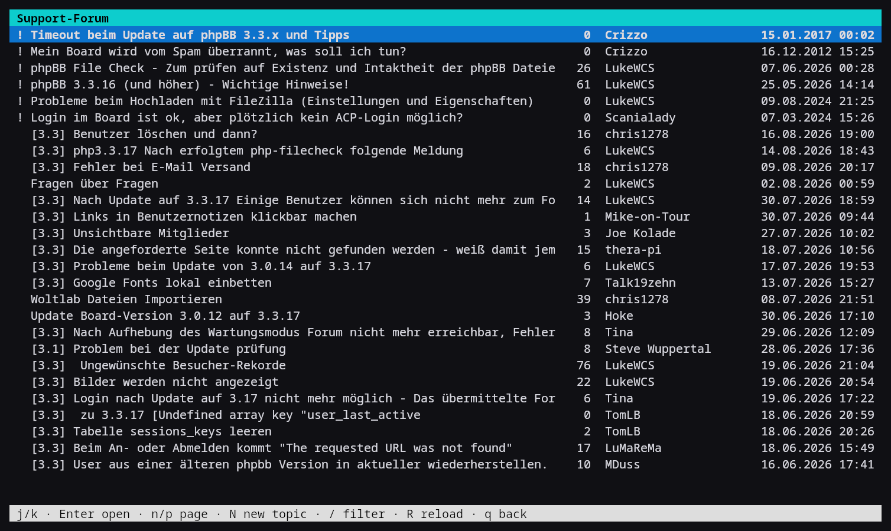
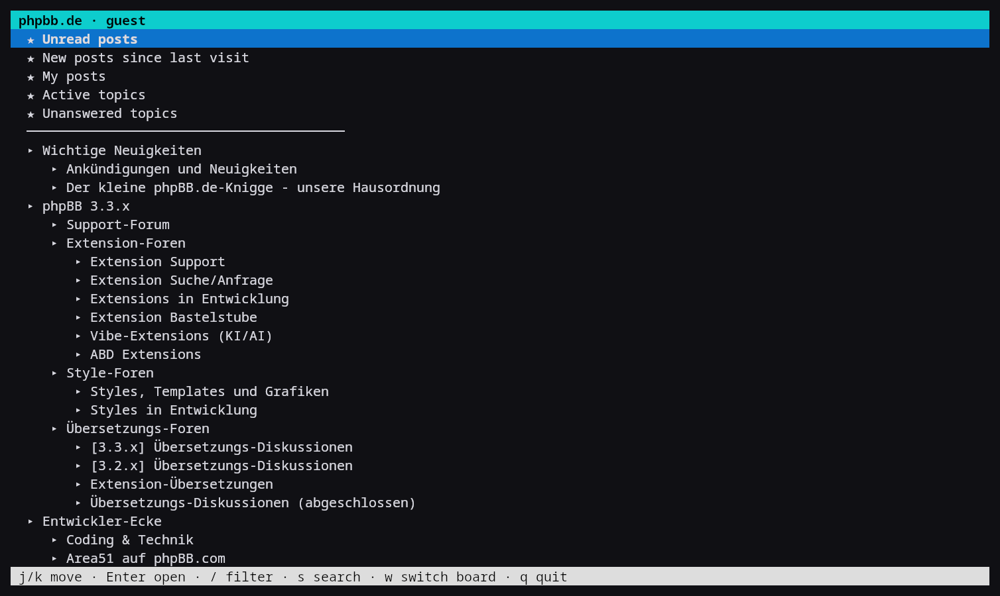
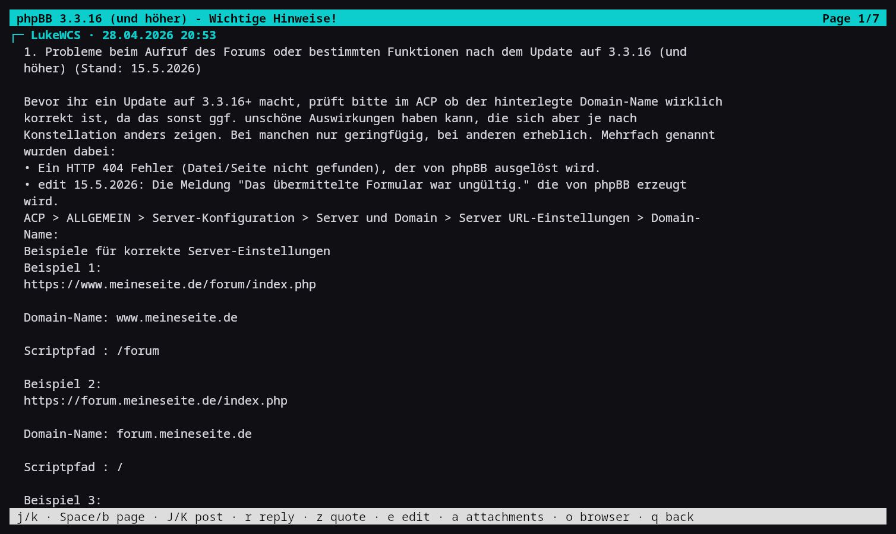

# phpbb-tui

Read and write phpBB forums from the terminal. Write posts in **Markdown** in
your own `$EDITOR`; they are converted to BBCode on send.

> **🇩🇪 Deutsche Fassung:** [ganz unten](#phpbb-tui-deutsch). 👇

---

## Honest foreword

I am **not a programmer**. I write in a phpBB forum every day and wanted to do
it from the terminal, where the rest of my work happens. The code was written
for me by **[Claude Code](https://claude.com/claude-code)**; I said what I
wanted, tried it out and said what still bothered me. I am publishing it
because there is nothing else of its kind, and because the pitfalls we ran into
are documented nowhere — the afternoon they cost us is written down below. 🙂

---



One line per topic — about thirty per screen. In a text browser the same page
shows **two**, because phpBB ships every topic row twice (desktop columns plus
a `responsive-show` block for phones) and a graphical browser hides one of them.

The forum tree comes from the board's own jump box, so it includes every forum
you may see:



Threads are plain text, with `┌─ author · date` between posts and quotes
indented:



*(Screenshots taken from the public phpBB.de support board, read as a guest
with `phpbb-tui phpbb.de --guest`.)*

## Why this exists

There is no maintained terminal client for phpBB. The only one findable is
`xqtr/phpbb-cli` — Pascal, two commits, 2017, read-only. `forum-dl` handles
phpBB but cannot log in. NNTP bridges and the unofficial REST API are
*server-side* extensions: the board owner must install them, so they are no
help to a normal user.

The reason the field is empty: phpBB has no public API (the bundled CLI is
server administration), and every board renders its own HTML. A client aiming
at *all* phpBB boards breaks on the next theme update. This one aims at the
subset every prosilver-derived board shares, which in practice is most of them.

## Tests

Run the offline regression suite with `python3 -m unittest discover -s tests`.
See [tests/README.md](tests/README.md) for its scope and limitations.

## Install

Python 3.11+ and `requests`. Nothing else — the interface uses `curses` from
the standard library, and HTML is parsed with `re` and `html.parser`.

```sh
git clone https://github.com/drdewes/phpbb-tui ~/src/phpbb-tui
ln -s ~/src/phpbb-tui/phpbb-tui.sh ~/.local/bin/phpbb-tui
phpbb-tui add https://forum.example.org/forum
```

`add` fetches the board, stores it in `~/.config/phpbb-tui/boards.toml` and
logs you in. Your password is never stored — only the session cookie, in
`~/.local/state/phpbb-tui/<board>.cookies.txt` (mode 600).

## Usage

```
phpbb-tui                 start (asks which board if several)
phpbb-tui <name>          open a specific board
phpbb-tui add <url>       add a board
phpbb-tui login <name>    log in again
phpbb-tui list            show configured boards
phpbb-tui logout <name>   drop the session
phpbb-tui <name> --guest  read without an account (boards that allow guests)
phpbb-tui --version       show the version
```

Vim keys throughout:

| Key | Action |
|-----|--------|
| `j` `k` | move |
| `l` `Enter` | open |
| `h` `q` | back |
| `Ctrl-D` `Ctrl-U` | half page |
| `g` `G` | top / bottom |
| `Space` `b` | page down / up |
| `n` `p` | next / previous page of results |
| `/` | filter the list |
| `M` | mark all forums read (menu) / this forum read (topic list) |
| `u` | next unread topic, straight from one to the next |
| `s` | search the board |
| `w` | switch board |
| `m` | private messages |
| `N` | new topic / new message |
| `r` | reply |
| `z` | quote reply |
| `e` | edit your own post |
| `a` | attachments of the current post |
| `J` `K` | next / previous post in a thread |
| `o` | open in the system browser |
| `f` | next mailbox (inbox → sent → outbox) |
| `d` | delete the message under the cursor |

## Reading

Unread topics (`●`) open **at the first new post**, on whichever page it is,
and new posts carry a `● new` marker. The menu lists the board's built-in
searches (unread, new since last visit, your posts, active, unanswered) and,
when logged in, your **subscribed topics** and **bookmarks**. Filtering the
forum tree with `/` shows where each hit lives (`Users › Duria 2`), so two
forums with the same name stay apart. `M` marks everything read after asking.

`u` reads through a list like a news reader: from the list or from inside a
topic it opens the next unread topic at its first new post, page after page,
without going back to the list in between. `q` returns to the list.

`n`/`p` follow the board's own page links, so boards with 10, 25 or 50 entries
per page all page correctly, including styles that never print "Page x of y".

For lost or unrecognized send confirmations, see
[TUI submission outcomes](docs/tui-submissions.md) before retrying.

The existing `n`/`p` controls follow the board’s
[pagination links](docs/tui-pagination.md).

Attachment downloads support `S` for save-as and confirmation before
[replacing existing files](docs/tui-downloads.md).

## Non-interactive / Automation

Read and write without entering curses, opening an editor or browser, or answering
prompts. The existing interactive commands and key bindings remain available.

```sh
phpbb-tui login example
phpbb-tui forums example --json
phpbb-tui topics example --forum 2 --page 1 --json
phpbb-tui topic example --topic 42 --json
phpbb-tui search example --unread --json
phpbb-tui search example --query "extension development" --json
phpbb-tui post example --forum 2 --subject "Report" --body-file report.md --dry-run
```

Run `login` explicitly to establish a session; automation commands reuse it and
fail if it expires. For unattended login, use `--user` with `--password-stdin`
or `--password`; see the [authentication reference](docs/authentication.md). Use `--guest` for an isolated anonymous session on boards
that allow guest access. `--quiet` suppresses successful output; it conflicts
with `--json`. Each command has `--help`.

See the [automation reference](docs/automation.md) for search modes, pagination,
local filtering, JSON fields, exit codes, and unattended examples. The
[posting reference](docs/posting.md) covers new topics, replies, quotes, edits,
preview, dry-run, and uncertain submissions. The
[PM reference](docs/private-messages.md) covers mailboxes, sending, replies,
quotes, and explicit deletion. The [attachment reference](docs/attachments.md)
covers listing, safe downloads, and adding files to posts or PMs where allowed.

## Private messages

`m` from the forum tree — or the `✉` entry at the top of it — opens the inbox.
The entry carries the number of unread messages; `●` marks them in the list.
`f` cycles through the three mailboxes phpBB always has: inbox, sent, and
outbox (sent but not yet read by the recipient).

Reading, replying and quoting work exactly as in a thread, because phpBB
serves messages through the same machinery — the compose form is even called
`postform` again. Only the recipient is different. phpBB does not accept a
name on submit: the name has to be resolved to a user id first, through its
own round trip, and comes back in the form as `address_list[u][id]`. So `N`
asks for recipients one at a time and checks each against the board
immediately; a typo is caught there rather than after you have written the
whole message. `Enter` on an empty line ends the list. Replies skip the
question — the board ships the recipient with the reply form.

Most boards switch attachments off for private messages. When the form has no
upload field, the preview simply does not offer `d` and `x`.

## Writing

`r`, `z`, `e` and `N` open `$EDITOR` on a Markdown file. The first line
(`# …`) is the subject. On save, the forum itself renders the preview — so you
see exactly what will appear — and only `a` sends it.

| Markdown | becomes |
|----------|---------|
| `**bold**` | `[b]…[/b]` |
| `*italic*` | `[i]…[/i]` |
| `> quote` | `[quote]…[/quote]` |
| `> **Name:**` as first line | `[quote="Name"]` |
| `- item` / `1. item` | `[list]` / `[list=1]` |
| `[text](url)` | `[url=…]…[/url]` |
| fenced block | `[code]…[/code]` |
| `# heading` | bold — BBCode has no headings |

**Nothing you write gets lost.** The text is saved as a draft every time the
editor closes (`~/.local/state/phpbb-tui/entwuerfe/`, mode 600) and removed
only when the board confirms the post or you discard it on purpose; `q` in
the preview asks first. After a crash, a rejection or an unclear result,
replying at the same place brings the text back, marked as a restored draft.

Quoting round-trips losslessly: `[quote="someone"]` becomes
`> **someone:**` for editing and turns back into `[quote="someone"]` on send.
Inline code stays plain text, because plain phpBB has no inline-code tag and
`[c]` would appear literally in the post.

## Attachments

In a thread, `a` lists the attachments of the post under the cursor; `Enter`
downloads and opens one, `s` only saves it (to `~/Downloads` by default).

While composing, `d` in the preview uploads a file to the open form and `x`
removes the last one. phpBB accepts the upload separately from the post and
hands the file back through the form as `attachment_data[n][…]` fields, which
must travel with the final submit — this client re-reads the whole form after
each upload so nothing is lost.

## Configuration

`~/.config/phpbb-tui/boards.toml`:

```toml
downloads = "~/Downloads"
browser   = "xdg-open"

[[board]]
name = "example"
url  = "https://forum.example.org/forum"
user = "myname"
```

`$BROWSER` is deliberately **not** used: on many systems it points at a
terminal browser, which is the last thing you want when opening an attachment.
Override with `PHPBB_TUI_BROWSER`, the editor with `PHPBB_TUI_EDITOR`.

The interface speaks English or German. It follows your locale; force it with
`PHPBB_TUI_LANG=en` or `PHPBB_TUI_LANG=de`.

## Slow start? IPv6

Some boards publish an IPv6 address that never answers. Browsers barely
notice, because they try both address families at once; Python's `requests`
tries them one after another and waits for the full timeout first, which made
every start against one board take 30 seconds. This client connects over IPv4
first and falls back to IPv6 only when there is no IPv4 address or it fails.

## Two things phpBB does that will cost you an afternoon

**A form submitted in the same second is rejected.** `check_form_key` computes
`$diff = time() - $creation_time` and then tests `if ($diff && …)` — which is
false when `$diff` is 0. A human typing a password always takes longer than a
second; a program does not, and gets *"The submitted form was invalid"*, which
reads exactly like a wrong password. This client waits until the form is old
enough before every POST.

**Do not treat `class="error"` as failure.** It also occurs in the page
scaffolding of successful posts. Check positively instead: the success message,
or the meta-refresh to `viewtopic.php…#pNNN`.

Two smaller ones, for anyone parsing prosilver: do not cut topic rows at the
next `</li>` (multi-page topics carry their own `<li>` page list inside the
row), and read the topic starter from `topic-poster` — the first username in
the row belongs to the mobile block and is the *last* poster.

## Finding the forums

The board index is not a reliable source: some boards list only a fraction of
their forums there. The **jump box** at the bottom of every forum page lists
every forum the logged-in user may see, with indentation, so that is what this
client reads.

## Limitations

Polls, moderation and the message rules of the personal area are not
implemented; press `o` and continue in the browser. Custom message folders
beyond the three built-in ones are ignored. Tested against phpBB 3.3 with a
prosilver-derived style.

## Acknowledgments

- **[William Jacoby (bonelifer)](https://github.com/bonelifer)** contributed
  the non-interactive command line (reading, posting, private messages,
  attachments), the regression test suite, a long list of fixes, and the TUI's
  uncertain-submission warning, board-driven paging and save-as downloads.
  His work was written with [Codex](https://openai.com/codex/).
- The interactive client was written with
  [Claude Code](https://claude.com/claude-code).

## License

MIT

---

# phpbb-tui (deutsch)

phpBB-Foren im Terminal lesen und schreiben. Beiträge entstehen in **Markdown**
im eigenen `$EDITOR` und werden beim Senden nach BBCode gewandelt.

## Ehrliches Vorwort

Ich bin **kein Programmierer**. Ich schreibe täglich in einem phpBB-Forum und
wollte das vom Terminal aus tun, wo auch der Rest meiner Arbeit stattfindet.
Den Code hat mir **[Claude Code](https://claude.com/claude-code)** gebaut; ich
habe gesagt, was ich will, es ausprobiert und gesagt, was mich noch stört. Ich
veröffentliche es, weil es nichts Vergleichbares gibt — und weil die
Stolpersteine, über die wir gefallen sind, nirgends dokumentiert sind. 🙂

Es gibt keinen gepflegten Terminal-Client für phpBB — der einzige auffindbare
hat zwei Commits von 2017 und kann nur lesen. Der Grund: phpBB hat keine
öffentliche Schnittstelle, und jedes Board liefert eigenes HTML.

## Einrichten

Python 3.11 oder neuer und `requests`, sonst nichts.

```sh
git clone https://github.com/drdewes/phpbb-tui ~/src/phpbb-tui
ln -s ~/src/phpbb-tui/phpbb-tui.sh ~/.local/bin/phpbb-tui
phpbb-tui add https://forum.example.org/forum
```

Das Passwort wird nirgends gespeichert, nur das Sitzungs-Cookie (Rechte 600).
Boards mit Gastzugang lassen sich auch ohne Konto lesen: `phpbb-tui <name> --guest`.

```
phpbb-tui                 starten (fragt bei mehreren Boards nach)
phpbb-tui <name>          ein bestimmtes Board öffnen
phpbb-tui add <adresse>   Board hinzufügen
phpbb-tui login <name>    neu anmelden
phpbb-tui list            eingerichtete Boards zeigen
phpbb-tui logout <name>   Sitzung verwerfen
phpbb-tui --version       Version zeigen
```

## Bedienung

Vim-Tasten überall:

| Taste | Wirkung |
|-------|---------|
| `j` `k` | bewegen |
| `l` `Enter` | öffnen |
| `h` `q` | zurück |
| `Strg-D` `Strg-U` | halbe Seite |
| `g` `G` | Anfang / Ende |
| `Leer` `b` | Bildschirmseite vor / zurück |
| `n` `p` | nächste / vorige Seite des Forums |
| `/` | Liste filtern |
| `M` | alles als gelesen markieren (Menü) bzw. dieses Forum (Themenliste) |
| `u` | nächstes ungelesenes Thema, direkt eins nach dem anderen |
| `s` | im Board suchen |
| `w` | Board wechseln |
| `m` | private Nachrichten |
| `N` | neues Thema / neue Nachricht |
| `r` | antworten |
| `z` | zitierend antworten |
| `e` | eigenen Beitrag bearbeiten |
| `a` | Anhänge des Beitrags |
| `J` `K` | nächster / voriger Beitrag im Thema |
| `o` | im Browser öffnen |
| `f` | nächstes Postfach (Eingang → Gesendet → Ausgang) |
| `d` | Nachricht unter dem Cursor löschen |

## Lesen

Ungelesene Themen (`●`) öffnen sich **beim ersten neuen Beitrag**, egal auf
welcher Seite er steht; neue Beiträge tragen ein `● neu`. Im Menü stehen die
Übersichten, die jedes phpBB anbietet (ungelesen, neu seit dem letzten Besuch,
eigene Beiträge, aktive und unbeantwortete Themen), und nach der Anmeldung
auch **abonnierte Themen** und **Lesezeichen**. Wer den Forenbaum mit `/`
filtert, sieht bei jedem Treffer, wo er hängt (`Benutzerforen › Duria 2`) —
zwei gleichnamige Foren bleiben so unterscheidbar. `M` markiert nach
Rückfrage alles als gelesen.

`u` liest eine Liste durch wie ein Newsreader: aus der Liste oder mitten aus
einem Thema öffnet es das nächste ungelesene Thema beim ersten neuen Beitrag,
Seite für Seite, ohne Umweg über die Liste. `q` führt zurück zur Liste.

`n`/`p` folgen den Seitenlinks des Boards selbst. Darum blättert der Client
richtig, ob ein Board 10, 25 oder 50 Einträge pro Seite zeigt, und auch bei
Styles, die nirgends „Seite x von y“ hinschreiben.

## Schreiben

`r`, `z`, `e` und `N` öffnen `$EDITOR` mit einer Markdown-Datei; die erste
Zeile mit `#` ist der Betreff. Nach dem Speichern zeigt das Forum selbst die
Vorschau, erst `a` sendet ab. Zitate laufen verlustfrei in beide Richtungen:
aus `[quote="jemand"]` wird `> **jemand:**` und beim Senden wieder dasselbe.

**Kein geschriebener Text geht verloren.** Jedes Mal, wenn der Editor zugeht,
wird der Text als Entwurf gesichert (`~/.local/state/phpbb-tui/entwuerfe/`,
Rechte 600). Gelöscht wird er erst, wenn das Forum den Beitrag bestätigt oder
du ihn ausdrücklich verwirfst; `q` in der Vorschau fragt vorher nach. Nach
einem Absturz, einer Ablehnung oder einem unklaren Ergebnis ist der Text beim
nächsten Antworten an derselben Stelle wieder da, als Entwurf gekennzeichnet.

Kommt nach dem Absenden keine eindeutige Antwort (Verbindung weg, unbekannte
Seite), warnt der Client: Der Beitrag ist **vielleicht schon gespeichert**,
bitte erst im Thema nachsehen. So entsteht kein Beitrag doppelt. Lehnt das
Forum eindeutig ab, geht es zurück in den Editor.

## Private Nachrichten

`m` im Forenbaum (oder der `✉`-Eintrag ganz oben) öffnet den Posteingang;
daneben steht die Zahl der ungelesenen, `●` markiert sie in der Liste. `f`
schaltet durch die drei Postfächer, die jedes phpBB hat: Eingang, Gesendet und
Postausgang — letzteres sind abgeschickte Nachrichten, die der Empfänger noch
nicht gelesen hat.

Einen Namen nimmt phpBB beim Absenden nicht entgegen, er muss vorher in einem
eigenen Gang zu einer Benutzernummer aufgelöst werden. Deshalb fragt `N` die
Empfänger einzeln ab und prüft jeden sofort gegen das Board — ein Tippfehler
fällt so vor dem Schreiben auf und nicht danach. Enter auf leerer Zeile
beendet die Liste. Beim Antworten entfällt die Frage.

## Anhänge

Im Thema listet `a` die Anhänge des Beitrags: Enter lädt und öffnet, `s`
speichert in den Download-Ordner, `S` fragt nach Ziel (Datei oder Ordner; ein
bloßer Name landet im Download-Ordner). Eine vorhandene Datei wird nur nach
Rückfrage ersetzt. Beim Schreiben hängt `d` in der Vorschau eine Datei an, `x`
entfernt die letzte. Bieten Boards für Nachrichten keine Anhänge an, fehlen
`d` und `x` dort.

## Ohne Oberfläche: Automatisierung

Alles Wichtige geht auch ohne Oberfläche, für Skripte und Zeitpläne, mit
`--json`, Exit-Codes und `--dry-run`:

```sh
phpbb-tui topics example --forum 2 --page 1 --json
phpbb-tui search example --unread --json
phpbb-tui post example --forum 2 --subject "Bericht" --body-file bericht.md --dry-run
```

Einzelheiten (englisch): [Automatisierung](docs/automation.md),
[Schreiben](docs/posting.md), [Nachrichten](docs/private-messages.md),
[Anhänge](docs/attachments.md).

## Einstellungen

`~/.config/phpbb-tui/boards.toml`:

```toml
downloads = "~/Downloads"
browser   = "xdg-open"

[[board]]
name = "example"
url  = "https://forum.example.org/forum"
user = "meinname"
```

`$BROWSER` wird bewusst **nicht** benutzt, weil es oft auf einen
Textbrowser zeigt. Eigener Browser über `PHPBB_TUI_BROWSER`, eigener Editor
über `PHPBB_TUI_EDITOR`. Die Oberfläche spricht Deutsch oder Englisch nach der
Systemsprache; festlegen mit `PHPBB_TUI_LANG=de` bzw. `en`.

## Langsamer Start? IPv6

Manche Boards veröffentlichen eine IPv6-Adresse, die nie antwortet. Browser
merken das kaum, weil sie beide Wege gleichzeitig probieren; Pythons
`requests` probiert nacheinander und wartet erst das Zeitlimit ab — bei einem
Board kostete das jeden Start 30 Sekunden. Dieser Client nimmt deshalb zuerst
IPv4 und weicht nur auf IPv6 aus, wenn es kein IPv4 gibt oder es versagt.

## Zwei phpBB-Eigenheiten, die Zeit kosten

Ein Formular, das in derselben Sekunde zurückkommt, gilt als ungültig
(`if ($diff && …)` in `check_form_key`) — das sieht aus wie ein
Passwortfehler. Und ein `class="error"` im HTML ist kein Fehler; das steht auch
auf Erfolgsseiten. Erfolg positiv prüfen.

## Dank

**[William Jacoby (bonelifer)](https://github.com/bonelifer)** hat die
Kommandozeile ohne Oberfläche (Lesen, Schreiben, Nachrichten, Anhänge), die
Testsammlung, viele Korrekturen und in der Oberfläche die Warnung bei
unklarem Absenden, das Blättern über die Seitenlinks und „Speichern unter“
beigetragen, geschrieben mit [Codex](https://openai.com/codex/).

## Lizenz

MIT
